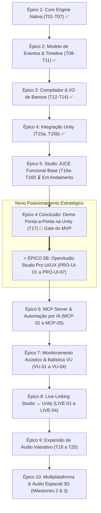

# Especificação de Épico — OpenAudio Studio Pro UI/UX (Paridade e Inspiração FMOD Studio)

## 1. Visão Geral e Motivação

Este documento especifica o novo **Épico 5B: OpenAudio Studio Pro UI/UX**, concebido a partir da análise sistemática das capturas de referência arquivadas em `docs/references/interface/`.

Enquanto o **Épico 5 (T16a–T16f)** provê os blocos funcionais mínimos e estruturais da DAW JUCE (Browser, Inspector, Timeline básica, Transporte e Mixer fundamental), o objetivo deste novo épico é elevar a interface do OpenAudio Studio a um patamar profissional de produto comercial, espelhando os padrões ergonômicos da indústria consolidados pelo FMOD Studio:
1. **Docking modular com Deck Inferior Contextual Dinâmico** (muda de acordo com o item selecionado: Playlist, Efeitos, Lógica, Automação ou Quantização).
2. **Timeline de alta produtividade com Visão Panorâmica (Overview Minimap)** e **Trilhas de Lógica Dedicadas**.
3. **Subfaixas de automação expansíveis** (Automation Sub-lanes) sob as pistas de áudio.
4. **Mixer Console profissional com árvore hierárquica de roteamento** e rack de inserts.
5. **Editor visual de Multi-instrumentos e playlists ponderadas**.
6. **Widget de espacialização 3D e radar de atenuação por distância**.
7. **Design System "OAE Dark Pro"** de alto contraste e legibilidade para longas sessões de áudio.

---

## 2. Análise Detalhada das Referências de Interface (`docs/references/interface/`)

A análise visual das 7 referências do FMOD Studio revelou padrões de UX cruciais que orientam este épico:

| Ref | Arquivo | Componente / Funcionalidade FMOD | Padrão Ergonômico Extraído |
| :--- | :--- | :--- | :--- |
| **01** | `01-event-editor-multitrack.png` | **Editor de Eventos Multifaixa** | Splitter de 3 colunas; transporte superior com timecode tabular; minimapa horizontal (Overview) sobre a régua com caixa de viewport arrastável/zoomável; cabeçalhos de faixa com Mute/Solo e fader; painel inferior de macros e envelopes AHDSR com visualização gráfica de curvas. |
| **02** | `02-mixer-routing-effects.png` | **Mixer, Roteamento e Efeitos** | Split-view no console: árvore hierárquica de roteamento à esquerda (`Routing Tree`), strips de canal verticais no centro/direita com medidores Peak/RMS ao lado dos faders de curso longo; Master fixo à direita; deck inferior com cadeia de efeitos (inserts) mostrando knobs gráficos e resposta visual de EQ. |
| **03** | `03-parameter-editor-spatializer.png` | **Editor por Parâmetro e Espacialização** | Abas de navegação na timeline alternando entre tempo e eixos contínuos de parâmetros (ex: RPM, Load); curvas de crossfade visual sobrepostas; radar circular 3D de azimute/elevação e gráfico cartesiano de curva de atenuação por distância. |
| **04** | `04-multi-instrument-playlist.png` | **Multi-instrumento e Playlist** | Ao selecionar um Multi-Instrument na timeline, o deck inferior abre a **Playlist View**: tabela com colunas de arquivo, peso percentual (`% Weight`) com barras proporcionais, modo `Shuffle`/`Random`/`Sequential`, e dials de randomização de pitch, volume e delay/offset. |
| **05** | `05-timeline-automation.png` | **Automação na Timeline** | Pistas filhas de automação (sub-lanes) dobráveis abaixo da faixa principal; nós de curva (breakpoints) com controle visual e interpolação; alinhamento visual preciso com as formas de onda de áudio. |
| **06** | `06-musical-arrangement.png` | **Arranjo Musical e Quantização** | Régua com divisão de tempos e compassos (`Bars:Beats`); marcações de tempo/BPM; deck inferior contextual de arranjo com seletores de quantização musical (`1/4`, `1/2`, `1 Bar`), polifonia máxima e modos de roubo de voz. |
| **07** | `07-logic-transitions.png` | **Lógica e Transições** | Pistas de lógica separadas acima das faixas de áudio; marcadores com bandeiras, regiões de loop (amarelas) e marcadores de transição direcionados; deck inferior contextual com construtor de condições por parâmetro e probabilidade com slider percentual. |

---

## 3. Estrutura do Novo Épico (Tarefas `PRO-UI-01` a `PRO-UI-07`)

### PRO-UI-01 — Design System "OAE Dark Pro" & Docking Flexível
- **Escopo:**
  - Implementar classe `OaeDarkLookAndFeel` derivada de `juce::LookAndFeel_V4`:
    - Paleta de cores profissional: fundo carvão `#1a1a1a`, superfícies `#242424`, bordas `#333333`, acentos em ciano `#00bcd4` (seleção/playhead), âmbar `#ffb300` (solo/loops), laranja `#ff7043` (mute/transições) e verde neon `#4caf50` (play/VU safe).
    - Tipografia tabular (números com largura fixa para timecode, frequências, dB e frames sem jitter visual).
    - Renderização antialiased de waveforms com pico (Peak) e média (RMS) sombreada em gradiente suave.
  - Gerenciador de layout com splitters colapsáveis bi-direcionais (esquerdo para Browser, central para Timeline/Mixer, direito para Inspector e inferior para Contextual Deck), com persistência do layout em `oae_studio_layout.json`.
- **Critérios de Aceitação (AC):**
  - O aplicativo inicializa com o tema uniforme sem artefatos ou elementos em cores padrão do sistema operacional; splitters mantêm suas posições relativas após fechar e reabrir a janela.

---

### PRO-UI-02 — Deck Inferior Contextual Dinâmico (Bottom Contextual Deck)
- **Escopo:**
  - Implementar o componente `ContextualBottomDeck` atuando como hospedeiro polimórfico de sub-editores.
  - Mecanismo de escuta de seleção global (`SelectionManager`):
    - Seleção de `MultiInstrument` -> ativa `PlaylistDeck`.
    - Seleção de `LogicItem` (marcador, região de loop, transição) -> ativa `LogicConditionsDeck`.
    - Seleção de `Track` ou `Bus` -> ativa `EffectChainDeck`.
    - Seleção de nó de curva ou envelope -> ativa `EnvelopeAhdsrDeck`.
    - Seleção de compasso ou grid musical -> ativa `MusicalQuantizeDeck`.
    - Nenhuma seleção -> exibe visão geral do projeto / console de build.
- **Critérios de Aceitação (AC):**
  - Clicar alternadamente entre um instrumento, um marcador de lógica e um bus no Mixer alterna o deck inferior instantaneamente em < 16 ms sem vazamento de memória ou perda de estado de edição.

---

### PRO-UI-03 — Editor de Playlist e Multi-Instrumentos (`PlaylistDeck`)
- **Escopo:**
  - Painel de gerenciamento de itens de playlist em estilo tabela FMOD:
    - Coluna de status, nome do sample, duração e barra horizontal de peso percentual (`% Weight`).
    - Arrastar a borda da barra de peso recalcula proporcionalmente os percentuais para somar 100%.
    - Modos de seleção com botões toggle: `Shuffle` (sem repetição por ciclo), `Random` (amostragem ponderada) e `Sequential`.
    - Seção de Modulação de Variação (Randomization Dials):
      - Slider de variação de Pitch (`+/- semitones`, faixa `0..48`).
      - Slider de variação de Volume (`+/- dB`, faixa `0..80`).
      - Slider de variação de Delay (`+/- ms`, faixa `0..5000`).
    - Botões de adicionar áudio (`+`), remover (`-`) e reordenar por arraste.
- **Critérios de Aceitação (AC):**
  - Alterar pesos percentuais e limites de randomização na UI atualiza o `project.json` v1 em conformidade com o schema e reflete no preview debounced.

---

### PRO-UI-04 — Timeline Avançada: Overview Minimap & Trilhas de Lógica Dedicadas
- **Escopo:**
  - **Overview Minimap:** Componente de faixa horizontal no topo da timeline exibindo uma versão condensada de toda a extensão do evento, com uma caixa de viewport deslizante e redimensionável para navegação horizontal e zoom bidirecional instantâneo.
  - **Logic Tracks:** Área separada no topo da timeline acima das pistas de áudio:
    - Faixas distintas para marcadores de tempo (`TempoMarker`), marcadores de navegação, regiões de loop (amarelas, com indicação visual de repetição) e regiões de transição direcionadas (com bandeiras).
    - Menu contextual ao clicar com botão direito na área de lógica: `Add Marker`, `Add Loop Region`, `Add Transition Marker`, `Add Sustain Point`.
    - Arraste de marcadores com snap magnético à régua de batidas/segundos.
- **Critérios de Aceitação (AC):**
  - Arrastar e redimensionar a caixa do Overview atualiza perfeitamente o scroll e o zoom da timeline principal; marcadores de lógica criados aparecem com ícones e cores conforme o tipo e persistem no projeto.

---

### PRO-UI-05 — Subfaixas de Automação Expansíveis na Timeline (Automation Sub-lanes)
- **Escopo:**
  - Adicionar botão de expansão/colapso (`+` / `-`) em cada cabeçalho de faixa de áudio para revelar pistas filhas de automação.
  - Subfaixa de automação contendo:
    - Menu dropdown para escolher o parâmetro de destino (Volume, Pan, Pitch, ou parâmetros de efeitos de bus).
    - Botão de habilitar/ignorar automação (`Bypass`).
    - Renderização de linha contínua de curva com nós editáveis (breakpoints).
    - Suporte visual aos tipos de curva do motor OAE: `LINEAR`, `HOLD`, `EASE_IN`, `EASE_OUT` e `S_CURVE`.
    - Adição de nó por clique duplo, exclusão por `Del` ou clique direito, arraste com snap e exibição de tooltip flutuante com o valor exato no cursor.
- **Critérios de Aceitação (AC):**
  - Criar pontos de automação na subfaixa atualiza o array `automation` no `project.json` v1; os nós são limitados ao teto de 32 pontos do motor e respeitam a ordenação estrita em X.

---

### PRO-UI-06 — Console de Mixer Profissional com Árvore de Roteamento & Effect Insert Deck
- **Escopo:**
  - Layout dividido no painel Mixer:
    - **Routing Tree View (Esquerda):** Exibe a árvore visual de roteamento (`Master`, buses filhos, VCAs, returns). Selecionar um nó foca no strip correspondente.
    - **Mixer Strips (Centro/Direita):** Faixas de canal verticais com fader de curso longo graduado de `-oo` a `+10 dB`, medidores estéreo duplos Peak/RMS em tempo real, pan pot estéreo, e botões Solo (`S`, amarelo) e Mute (`M`, laranja) com regra hierárquica.
    - **Master Strip Fixo:** Fixado à extrema direita com medidor master de maior largura e indicador de saturação (clip red light).
    - **Effect Insert Deck (no Contextual Bottom Deck):**
      - Quando um bus está selecionado, o deck inferior renderiza a cadeia de processamento (`EQ3`, `Compressor`, `Limiter`, `Reverb`, `Delay`).
      - Visualizador interativo de curva de EQ3 (Low, Mid, High) com nós de ganho/frequência arrastáveis.
      - Dials rotativos estilizados para parâmetros de cada efeito.
- **Critérios de Aceitação (AC):**
  - Mover faders e pan pots atualiza os volumes em tempo real durante o preview de áudio; medidores respondem à amplitude RMS/Peak de saída; efeito EQ exibe graficamente a atenuação/reforço.

---

### PRO-UI-07 — Prévia espacial local (3D Spatializer Deck)

- O radar representa o ouvinte no centro e o emissor no plano horizontal X/Z. Arrastar o emissor ajusta o ganho e o pan estéreo da instância de audição local enquanto a aba está ativa.
- A distância mínima delimita o trecho de ganho unitário. A distância máxima determina o raio do radar e o ponto de silêncio. O gráfico mostra a mesma curva de ganho aplicada à audição, com opções linear, inversa e quadrática.
- Os controles pertencem à sessão de prévia. Ao trocar de aba, a instância recupera seus ajustes de ganho e pan. A publicação e a reprodução remota usam seus próprios dados de áudio.
- **Aceite.** Abra um evento longo, ative a aba e inicie a reprodução local. Arraste o emissor do centro até a borda para ouvir a atenuação. Mova o emissor para a esquerda ou para a direita para comparar o pan. Alterne para Mixer e confira o retorno da audição normal.

---

## 4. Decisão de Prioridade e Posicionamento no Roadmap

### Decisão Técnica: Onde este novo épico deve entrar?

> **Decisão Aprovada:**
> O **Épico 5B (OpenAudio Studio Pro UI/UX)** deve ser posicionado **imediatamente após a conclusão e validação do MVP Vertical Slice (pós-T17)** e **À FRENTE dos Épicos 6 (`MCP Server`), 7 (`VU Balística`), 8 (`Live-Linking`) e 9 (`Expansão de Áudio`)**.

---

### Fundamentação Técnica e Comparativa da Priorização

#### 1. Por que NÃO entrar antes de T16c–T16f e T17?
- **Preservação do MVP Vertical Slice:** O compromisso primordial da engenharia é fechar a prova de valor ponta a ponta (Core Engine C++ -> CLI bankc -> Unity Package -> JUCE Studio básico -> Demonstração jogável na Unity na T17).
- **Dependência Funcional:** T16c a T16f criam as estruturas fundamentais em C++: o documento transacional, o browser em árvore, o serializador de projeto, o despachante de comandos e o preview assíncrono debounced. Tentar construir interfaces ricas (como o Overview Minimap ou a Playlist View dinâmica) sem essas classes prontas geraria código especulativo e retrabalho massivo.

#### 2. Por que entrar ANTES do Épico 6 (MCP Server: MCP-01 a MCP-05)?
- **Integridade dos `ComponentID`s Semânticos:** A tarefa `MCP-01` exige atribuir IDs semânticos determinísticos a todos os componentes da interface JUCE, e a `MCP-03` cria tools de IA (`studio_trigger_control`, `studio_select_item`, `studio_move_clip`, `studio_set_mixer_fader`, etc.).
- **Prevenção de Quebra de Contratos de IA:** Se implementássemos o MCP Server sobre a interface provisória do T16 e depois criássemos o Épico Pro UI, a introdução do Contextual Bottom Deck, dos novos strips de mixer e das trilhas de lógica **invalidaria os seletores de componentes e os scripts de teste automatizado de IA**, exigindo uma refatoração completa do MCP Server. Construindo a interface definitiva antes, o MCP Server já nascerá automatizando a interface final.

#### 3. Por que entrar ANTES do Épico 7 (VU Balística) e Épico 8 (Live-Linking)?
- **Hospedagem Natural de Recursos:** O Épico 7 implementa balísticas analógicas (IEC 60268-17) e escalas EBU R128 / K-System. Ter o console de mixer profissional com os strips verticais refinados (`PRO-UI-06`) já implementados torna a integração das balísticas uma simples atualização de rotina de renderização no componente existente.
- **Usabilidade em Tempo Real:** O Live-Linking (Épico 8) conecta a DAW ao jogo rodando na Unity para ajuste fino ao vivo. Uma interface com a ergonomia do FMOD Studio permite que o sound designer realize essa mixagem com total conforto visual e precisão tátil.

#### 4. Por que NÃO entrar por último (após Épico 10)?
- Colocar o acabamento da interface por último forçaria o projeto a operar com uma interface primitiva e pouco ergonômica durante meses de desenvolvimento e testes. Isso prejudicaria a produtividade, tornaria a validação de fluxos sonoros penosa e acumularia uma dívida técnica enorme de readequação de UI.

---

## 5. Relação com Tarefas Futuras do Motor (T21 e M3-3D)

A análise das telas de referência identificou duas capacidades no FMOD Studio que dependem de recursos previstos em épicos posteriores da engine nativa:
1. **Parameter Sheets na Timeline (Imagem 03):** Abas onde o eixo horizontal representa um parâmetro contínuo (ex: RPM). Essa capacidade está prevista no motor como **T21** (Épico 9). O componente de Timeline criado em `PRO-UI-04` deve ser projetado com arquitetura de abas (`juce::TabbedComponent`), mantendo a aba "Timeline" ativa no MVP e deixando a infraestrutura de UI desacoplada para receber as abas de parâmetros quando a T21 for implementada.
2. **Motor DSP Espacial 3D (Imagem 03).** O suporte nativo completo está planejado em **M3-3D** (Épico 10). Na Unity, o `StudioEventEmitter` usa posição e distâncias configuradas na cena com o `StudioListener`. O deck usa a API de volume e pan da instância para a prévia local. A persistência de propriedades espaciais no projeto e no banco depende de um contrato de autoria e reprodução em jogo.

---

## 6. Conclusão e Próximos Passos

1. **Avanço Imediato:** O fluxo contínuo autorizado prossegue normalmente para o fechamento dos contratos aprovados na Decisão 001, resolução de T12/T13 e execução sequencial de **T16c, T16d, T16e, T16f e T17 (MVP Vertical Slice)**.
2. **Ativação do Épico 5B:** Assim que a T17 for validada com a suíte de testes ponta a ponta na Unity, o **Épico 5B (OpenAudio Studio Pro UI/UX)** será acionado antes de iniciar o Épico 6 (MCP Server).
